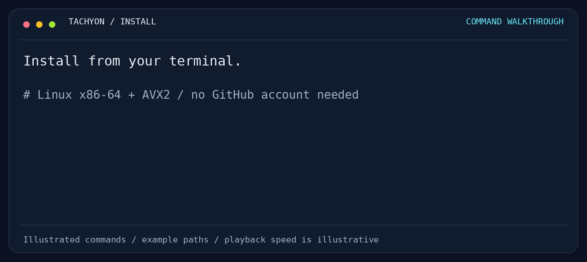
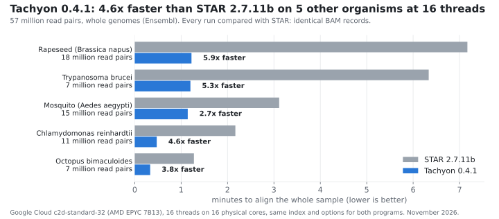

# Tachyon 0.4.1

**STAR 2.7.11b, faster.** Tachyon is a faster build of the STAR 2.7.11b RNA-seq aligner. Keep your STAR index and your command, change the program name, and get the same alignment records, splice junctions and gene counts as STAR in the author's tested configurations.

[](LICENSE)
[](https://github.com/AntonelloColangelo/Tachyon/releases/latest)
[](https://doi.org/10.5281/zenodo.24155618)

<p align="center"><a href="#install">Install</a> · <a href="#use">Use</a> · <a href="#benchmarks">Benchmarks</a> · <a href="#validation-and-limitations">Validation</a> · <a href="#cite-and-support">Cite</a> · <a href="#license-and-attribution">License</a></p>

<p align="center">
  <picture>
    <source media="(prefers-color-scheme: dark)" srcset="docs/benchmark-whole-samples-dark.svg">
    
  </picture>
</p>

Eight complete human RNA-seq samples, 375 million reads and read pairs, aligned to the whole human genome: **STAR 2.7.11b took 42.2 minutes, Tachyon 0.4.1 took 15.7 minutes, 2.7 times faster**. Every Tachyon run was compared with STAR on the same sample, and the output was identical record by record.

The method and all the results are in the preprint: Colangelo A., *Tachyon accelerates RNA-seq alignment while preserving STAR outputs in a multispecies benchmark*, Zenodo (2026), [doi:10.5281/zenodo.24155618](https://doi.org/10.5281/zenodo.24155618).

Tachyon exists because of STAR. If Tachyon is useful to you, please consider starring both the [STAR repository](https://github.com/alexdobin/STAR) and [this one](https://github.com/AntonelloColangelo/Tachyon).

> [!NOTE]
> **Research use only.** Tachyon is a separate project from STAR. The executables are free for individual, non-commercial use; commercial use and use by organizations need a license from the author (see [LICENSE](LICENSE)). All tests were run by the author, and Tachyon has not been independently validated.

<a id="requirements"></a>

## Install

You need 64-bit x86 Linux with AVX2, and `curl`, `tar` and `sha256sum`. You do not need a GitHub account or administrator rights. Run this in a terminal:

```bash
curl -fsSL https://raw.githubusercontent.com/AntonelloColangelo/Tachyon/tachyon-0.4.1/install.sh | bash
```

The installer downloads the latest release, verifies its checksums and installs `Tachyon` in `~/.local/bin`, with no compilation. Wait for `Tachyon is ready`, then check with `Tachyon --version`. If the installer prints PATH instructions, follow them. A `STOP:` message explains any problem.

To update, run the same command again. To remove Tachyon, run `rm ~/.local/bin/Tachyon`.

<a id="fixed-version"></a>

**A fixed version for pipelines and methods.** The command above always installs the latest release, so the same line can give different versions at different times. In a pipeline, or in the methods of an analysis, install a fixed version instead. These lines download Tachyon 0.4.1 and check it against its published SHA-256 before installing it:

```bash
curl -fsSLO https://github.com/AntonelloColangelo/Tachyon/releases/download/tachyon-0.4.1/tachyon-0.4.1-linux-x86_64.tar.gz
echo "84186171417e309c192c982312e6c4a0c458fd09917dd4c7ed580f1efbd49aa2  tachyon-0.4.1-linux-x86_64.tar.gz" | sha256sum --check
tar xzf tachyon-0.4.1-linux-x86_64.tar.gz
install -D -m 755 tachyon-0.4.1-linux-x86_64/Tachyon ~/.local/bin/Tachyon
~/.local/bin/Tachyon --version
```

`sha256sum` must print `OK`, and the last line must print `Tachyon 0.4.1`. If your terminal cannot find `Tachyon` afterwards, add `export PATH="$HOME/.local/bin:$PATH"` to `~/.bashrc` and open a new terminal.

Allow enough RAM for your genome index. STAR needs about 32 GB for a full human index, and Tachyon used 8% to 28% more memory than STAR in the author's tests.

<a id="advanced-installation"></a>
<a id="other-ways-to-install"></a>

<details>
<summary>Install in another folder or for every user</summary>

**Another folder.** Set `TACHYON_PREFIX` to install the command in `FOLDER/bin`:

```bash
curl -fsSL https://raw.githubusercontent.com/AntonelloColangelo/Tachyon/tachyon-0.4.1/install.sh | TACHYON_PREFIX=/some/folder bash
```

**For every user of a computer.** Run the [installation command](#install), then copy the executable with administrator rights:

```bash
sudo install -m 755 ~/.local/bin/Tachyon /usr/local/bin/Tachyon
```

</details>

## Use

Replace `STAR` with `Tachyon` in your STAR 2.7.11b command. For paired-end reads and a coordinate-sorted BAM:

```bash
Tachyon --runThreadN 8 \
    --genomeDir /path/to/index \
    --readFilesIn reads_1.fastq.gz reads_2.fastq.gz \
    --readFilesCommand zcat \
    --outSAMtype BAM SortedByCoordinate
```

Replace the example index path and read file names with your own. Keep your STAR 2.7.11b index, options and output file names. The [STAR manual](doc/STARmanual.pdf), by Alexander Dobin, describes every option.

For real analyses, build new indexes with STAR 2.7.11b. Tachyon's own index generation has been checked only on a small synthetic genome so far.

<a id="check-it-on-your-own-data"></a>

### Check it on your own data

Before relying on Tachyon, run STAR 2.7.11b and Tachyon on a sample of your own data with the same options, then compare the two output folders with [compare_with_star.sh](compare_with_star.sh). It needs `samtools`, and a few million read pairs are enough for a first check:

```bash
# 2 million read pairs from your sample
zcat reads_1.fastq.gz | head -n 8000000 > sample_1.fastq
zcat reads_2.fastq.gz | head -n 8000000 > sample_2.fastq

# the same command twice: only the program name and the output folder change
STAR --runThreadN 8 --genomeDir /path/to/index --readFilesIn sample_1.fastq sample_2.fastq \
    --outSAMtype BAM SortedByCoordinate --quantMode GeneCounts --outFileNamePrefix star/
Tachyon --runThreadN 8 --genomeDir /path/to/index --readFilesIn sample_1.fastq sample_2.fastq \
    --outSAMtype BAM SortedByCoordinate --quantMode GeneCounts --outFileNamePrefix tachyon/

# compare the two folders
curl -fsSLO https://raw.githubusercontent.com/AntonelloColangelo/Tachyon/tachyon-0.4.1/compare_with_star.sh
bash compare_with_star.sh star tachyon
```

The expected result ends like this, with the same number N of records from both programs:

```text
Aligned.sortedByCoord.out.bam: N records from STAR, N from Tachyon

Compared: Aligned.sortedByCoord.out.bam SJ.out.tab ReadsPerGene.out.tab Log.final.out
SAME AS STAR
```

The two BAM files will still differ in size and checksum, because Tachyon compresses them with libdeflate. The script compares what they contain: the decoded alignment records, the header without the `@PG` line, the splice junctions, the gene counts and the mapping statistics. If it prints `DIFFERENT FROM STAR`, check that both runs used the same reads, index, options and `--runThreadN`, and [open an issue](https://github.com/AntonelloColangelo/Tachyon/issues) with the files it lists.

<a id="terminal-demos"></a>

<details>
<summary>Watch the installation and the switch from STAR to Tachyon</summary>

These animations show the commands above with example paths. The playback speed is illustrative.




</details>

## Benchmarks

The speed-up holds beyond human. On six other organisms, from a protist to a plant, **STAR took 61.4 minutes and Tachyon 17.5 minutes, 3.5 times faster**, again with identical BAM records in every run.

<p align="center">
  <picture>
    <source media="(prefers-color-scheme: dark)" srcset="docs/benchmark-organisms-dark.svg">
    
  </picture>
</p>

With 16 threads on 16 physical cores the gap grows. On the same samples of five of these organisms **STAR took 20.1 minutes and Tachyon 4.4 minutes, 4.6 times faster**, with identical BAM records in every run.

<p align="center">
  <picture>
    <source media="(prefers-color-scheme: dark)" srcset="docs/benchmark-organisms-16t-dark.svg">
    
  </picture>
</p>

<p align="center"><a href="docs/benchmark-whole-samples.md">Benchmark details: samples, index, hardware, commands and limitations</a> · <a href="docs/benchmark-k562.md">Earlier K562 benchmark</a></p>

## Validation and limitations

The author compared Tachyon 0.4.1 with STAR 2.7.11b on the same data: paired-end and single-end bulk RNA-seq on x86-64 Linux, with 8 to 16 threads, on human data and on fruit fly, yeast, octopus, *Chlamydomonas*, *Trypanosoma brucei*, *Aedes*, *Brassica* and *Paramecium*. The tests covered unsorted and coordinate-sorted BAM, gene counts and two-pass mapping. Other modes and platforms need their own validation.

<a id="what-identical-means"></a>
<a id="limitations"></a>

<details>
<summary>What "identical" means, expected differences, and what was not tested</summary>

### What "identical" means

The author compared Tachyon with STAR 2.7.11b with a fixed comparison script, using the same input files, index, options and number of threads. [compare_with_star.sh](compare_with_star.sh) applies the same criterion to your own runs. These outputs must match:

- the alignment records in BAM or SAM files, compared as decoded text. The order of records at the same position can vary between runs and thread counts, also with STAR;
- `SJ.out.tab`, `ReadsPerGene.out.tab` and `Log.final.out`, excluding the lines with dates and speeds.

### Expected differences

- The program name and version differ in the `@PG` header line, which uses `ID:Tachyon`, and in `--version`, screen messages and `Log.out`.
- Tachyon compresses BAM files with libdeflate, so compressed files differ in size and checksum even when they contain the same records.
- Version 0.4.1 has a known defect: an unsorted BAM written with `--outBAMcompression 9` can be slightly larger than one written with level 1. The records are the same.
- Tachyon does not fix STAR 2.7.11b's bugs. Where it produces the same alignments as STAR, it also has STAR's known bugs and limits. See the STAR issue tracker.
- The shared-memory options, `--genomeLoad`, were rewritten and behave differently from STAR in a few rare error cases. See M1, M2 and D1-D4 in [CHANGES.md](CHANGES.md).

### Not tested

- STARsolo for single-cell data, TachyonLong, chimeric or fusion detection, WASP, genome generation, and `--genomeLoad` with shared memory.
- Outputs not listed above, such as `Aligned.toTranscriptome.out.bam`, `Chimeric.out.*`, `Unmapped.out.mate*` and `Signal.*`.
- Mac OS X, ARM, and builds with non-default compiler flags.

The untested modes use STAR's code with the Tachyon changes enabled or disabled. Their output has not been systematically compared with STAR. Results on the tested data do not prove identical output for all data. For very large or very small genomes, follow the parameter recommendations in the STAR manual.

</details>

<a id="architecture"></a>

## How it works

Tachyon is STAR 2.7.11b with performance changes. It keeps STAR's index format and alignment rules, including its random seed and multithreaded behavior. Each performance change applies only when its conditions are met, as reported in `Log.out`. Setting `TACHYON_LEVE=0` turns all of them off (see [CHANGES.md](CHANGES.md)); the tests used the default settings.

The published build targets x86-64 CPUs with AVX2. This release has no CUDA (GPU) path.

The optional `--genomeLoad Mmap` mode maps the index files from the page cache instead of making a private copy; the default remains `NoSharedMemory`. Mapped pages still count towards RSS, and `Mmap` has restrictions on adding junctions or sequences at alignment time.

A fixed seed and one thread make a run repeatable on the test data, but they do not guarantee the same primary alignment or record order across thread counts or for every input.

<a id="author-and-support"></a>

## Cite and support

If you use Tachyon in published work, please cite both:

- Colangelo A. [Tachyon accelerates RNA-seq alignment while preserving STAR outputs in a multispecies benchmark](https://doi.org/10.5281/zenodo.24155618). Zenodo (2026).
- Dobin A. et al. [STAR: ultrafast universal RNA-seq aligner](https://www.ncbi.nlm.nih.gov/pubmed/23104886). Bioinformatics 29(1):15-21 (2013).

For questions about Tachyon, contact Antonello Colangelo through this repository. Do not send Tachyon support requests to the STAR project or to Alexander Dobin, and report a problem to the STAR project only if you can reproduce it with STAR itself.

[CHANGES.md](CHANGES.md) lists the Tachyon changes first, followed by STAR's history. STAR's release notes are in [RELEASEnotes.md](https://github.com/alexdobin/STAR/blob/2.7.11b/RELEASEnotes.md).

## Research use only

Tachyon is research software. It is not a medical device and is not CE-marked, FDA-cleared, or certified for diagnostic use.

Do not use its results to diagnose, treat, or make decisions about patients unless your laboratory has validated it for that purpose under the rules that apply to you, such as ISO 15189, CLIA, or the EU IVDR. You are responsible for that validation.

Tachyon is provided without warranty. See [LICENSE](LICENSE), sections 6, 7, and 7a.

<a id="about-tachyon-and-star"></a>
<a id="license"></a>

## License and attribution

© Antonello Colangelo, 2026, for the Tachyon changes. All rights reserved. Tachyon is not open source and its source code is not published. An individual may run the released executables free of charge for non-commercial use; commercial use, use by organizations and redistribution need a written license. The Software remains the property of the author. See [LICENSE](LICENSE).

Tachyon is based on STAR 2.7.11b, Spliced Transcripts Alignment to a Reference, by Alexander Dobin, released under the MIT License. It also includes htslib, opal, SIMDe, bam_cat and SimpleGoodTuring, and links zlib and libdeflate. STAR and these components keep their own licenses, listed with their copyright notices in [THIRD_PARTY_NOTICES.md](THIRD_PARTY_NOTICES.md).

Tachyon is a separate project and is not an official STAR release. Alexander Dobin, Cold Spring Harbor Laboratory, the National Institutes of Health, and the authors and institutions behind its other components do not develop, review, or endorse Tachyon. See [LICENSE](LICENSE), section 4. The name STAR identifies the software Tachyon is based on.

<a id="funding"></a>
<a id="directory-contents"></a>

<details>
<summary>Funding and repository contents</summary>

### Funding

STAR 2.7.11b, the code Tachyon is based on, was developed by Alexander Dobin. The development of STAR is supported by the National Human Genome Research Institute of the National Institutes of Health under Award Number R01HG009318. The content is solely the responsibility of the authors and does not necessarily represent the official views of the National Institutes of Health.

Antonello Colangelo funded the Tachyon optimizations and their testing and validation himself. This work received no NIH funding. Neither the National Institutes of Health nor Alexander Dobin endorse Tachyon.

### Repository contents

- `install.sh` is the installer used by the [installation command](#install), and `compare_with_star.sh` the comparison described in [Check it on your own data](#check-it-on-your-own-data).
- `bin` contains unchanged, precompiled STAR 2.7.11b executables by Alexander Dobin for Linux and Mac OS X, under the MIT License. The Tachyon executable comes from a release, as described in [Install](#install).
- `doc` contains the documentation, `docs` the benchmark pages and figures, and `extras` miscellaneous files and scripts.

</details>
