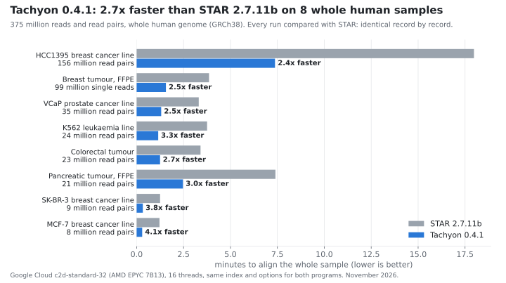
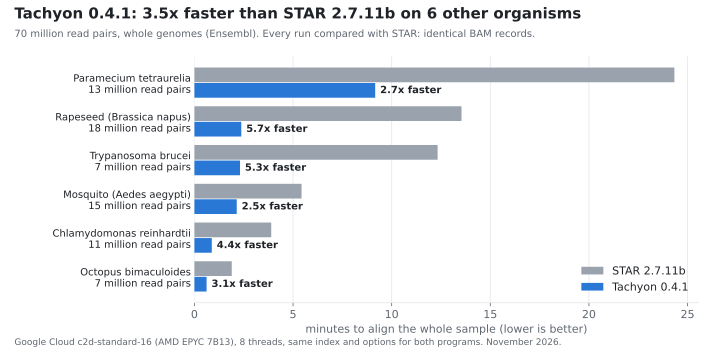
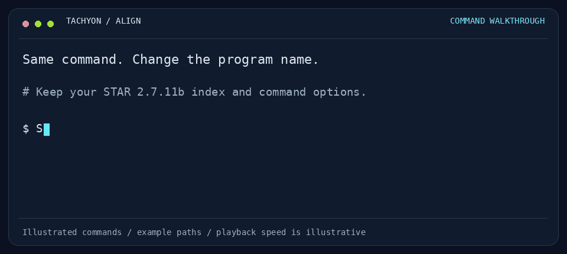

# Tachyon 0.4.1

Tachyon accelerates STAR 2.7.11b RNA-seq alignment while matching its alignment records and splice junctions in the author's tested configurations.

[](LICENSE)
[](https://github.com/AntonelloColangelo/Tachyon/releases/latest)

<p align="center">
  <picture>
    <source media="(prefers-color-scheme: dark)" srcset="docs/benchmark-whole-samples-dark.svg">
    
  </picture>
</p>

Eight complete human RNA-seq samples, 375 million reads and read pairs, aligned to the whole human genome: **STAR 2.7.11b took 42.2 minutes, Tachyon 0.4.1 took 15.7 minutes, 2.7 times faster**. Every Tachyon run was compared with STAR on the same sample, and the output was identical record by record.

<p align="center">
  <picture>
    <source media="(prefers-color-scheme: dark)" srcset="docs/benchmark-organisms-dark.svg">
    
  </picture>
</p>

The same holds beyond human: on six other organisms, from a protist to a plant, **STAR took 61.4 minutes and Tachyon 17.5 minutes, 3.5 times faster**, again with identical BAM records in every run.

<p align="center"><a href="docs/benchmark-whole-samples.md">Benchmark details: samples, index, hardware, commands and limitations</a> · <a href="docs/benchmark-k562.md">Earlier K562 benchmark</a></p>

**Research use only.** Tachyon is a separate project from STAR. The executables are free for individual, non-commercial use; commercial use and use by organizations need a license from the author (see [LICENSE](LICENSE)). All tests were run by the author. Tachyon has not been independently validated.

## Requirements

The prebuilt installer below requires 64-bit x86 Linux with AVX2, `curl`, `tar` and `sha256sum`. It needs no GitHub account.

Allow enough RAM for your genome index and alignment. STAR needs about 32 GB for a full human index; Tachyon used 8% to 28% more memory than STAR in the author's tests.

## Install

Run this in a terminal:

```bash
curl -fsSL https://raw.githubusercontent.com/AntonelloColangelo/Tachyon/tachyon-0.4.1/install.sh | bash
```

The installer downloads the latest release, verifies its checksums, and installs `Tachyon` in `~/.local/bin`, without compilation or administrator rights. Wait for `Tachyon is ready`, then check with `Tachyon --version`. Follow any PATH instructions printed by the installer. A `STOP:` message explains any problem.

Run the same command to update. To remove the executable, run `rm ~/.local/bin/Tachyon`.

## Use

Replace `STAR` with `Tachyon` in your existing STAR 2.7.11b command. For paired-end reads and a coordinate-sorted BAM:

```bash
Tachyon --runThreadN 8 \
    --genomeDir /path/to/index \
    --readFilesIn reads_1.fastq.gz reads_2.fastq.gz \
    --readFilesCommand zcat \
    --outSAMtype BAM SortedByCoordinate
```

Replace the example index path and read filenames with your own. Keep your STAR 2.7.11b index, options, and output filenames. Use STAR 2.7.11b to build new indexes for real analyses. Tachyon index generation is exercised on the small synthetic fixture; broader validation is still needed.

Before relying on Tachyon, compare it with STAR 2.7.11b on a sample of your own data using your own options. The [STAR manual](doc/STARmanual.pdf), by Alexander Dobin, describes the STAR 2.7.11b options.

## Terminal demos

<details>
<summary>Watch the animated installation and command walkthroughs</summary>

These animations illustrate the commands above using example paths and presentation timing.

### Install Tachyon


[Copy the installation command](#install).

### From STAR to Tachyon



[Copy the alignment example](#use).

</details>

## Validation and limitations

The comparisons cover paired-end and single-end bulk RNA-seq on x86-64 Linux, with 8 to 16 threads. They include unsorted and coordinate-sorted BAM, gene counts, and two-pass mapping. Other modes and platforms require their own validation.

<a id="what-identical-means"></a>
<a id="limitations"></a>

<details>
<summary>Comparison criteria, tested configurations, and known limitations</summary>

### What "identical" means

The author used a fixed comparison script to compare Tachyon with STAR 2.7.11b, using the same input files, index, options, and number of threads. The comparison requires the following to match:

The alignment records in BAM or SAM files, compared as decoded text. The order of records at the same position can vary between runs and thread counts, including with STAR.

`SJ.out.tab`, `ReadsPerGene.out.tab`, and `Log.final.out`, excluding lines with dates and speeds.

The following differences are expected:

The program name and version differ in the `@PG` header line, which uses `ID:Tachyon`, as well as in `--version`, screen messages, and `Log.out`.

Tachyon uses libdeflate to compress BAM files. Compressed files therefore differ in size and checksum even when they contain the same records.

Version 0.4.1 has a known defect: an unsorted BAM written with `--outBAMcompression 9` can be slightly larger than one written with level 1. The records are the same.

Tachyon does not fix STAR 2.7.11b's bugs. Where it produces the same alignments as STAR, it also has STAR's known bugs and limits. See the STAR issue tracker.

The shared-memory options, `--genomeLoad`, were rewritten and behave differently from STAR in a few rare error cases. See M1, M2, and D1-D4 in [CHANGES.md](CHANGES.md).

### Limitations

The author's tests compared Tachyon 0.4.1 with STAR 2.7.11b on the same data. They covered paired-end and single-end bulk RNA-seq on x86-64 Linux, with 8 to 16 threads. Tests included human data and data from several other organisms, including fruit fly, yeast, octopus, Chlamydomonas, Trypanosoma brucei, Aedes, Brassica, and Paramecium. The tested configurations included unsorted and coordinate-sorted BAM, gene counts, and two-pass mapping.

The broader author-run tests did not cover:

STARsolo for single-cell data, TachyonLong, chimeric or fusion detection, WASP, genome generation, or `--genomeLoad` with shared memory.

Outputs other than those listed in [What "identical" means](#what-identical-means), such as `Aligned.toTranscriptome.out.bam`, `Chimeric.out.*`, `Unmapped.out.mate*`, and `Signal.*`.

Mac OS X, ARM, or builds with non-default compiler flags.

The untested modes use STAR's code with the Tachyon changes enabled or disabled. Their output has not been systematically compared with STAR.

Results on the tested data do not establish identical output for all data. Compare Tachyon with STAR 2.7.11b on a sample of your own data, using your own options, before relying on it.

For very large or very small genomes, follow the parameter recommendations in the STAR manual.

</details>

## Architecture

Tachyon is based on STAR 2.7.11b and keeps its index format and its alignment rules. The optional `--genomeLoad Mmap` mode maps index files from the page cache instead of making a private copy; the default remains `NoSharedMemory`. Mapped pages still contribute to RSS, and `Mmap` has restrictions on adding junctions or sequences at alignment time. The published build targets x86-64 CPUs with AVX2; this release provides no CUDA execution path. The performance changes apply only when their conditions are met, as reported in `Log.out`.

Alignment selection follows STAR's rules, including its random seed and multithreaded behavior. A fixed seed and one thread make the repeatability check useful for this fixture; they do not establish deterministic primary-alignment selection or record order across thread counts or all inputs.

## Roadmap

Priorities include publishing a fully reproducible benchmark harness with input and index checksums, extending differential tests to more datasets and thread counts, and validating additional modes such as STARsolo, chimeric alignments and real-data index generation. These are directions for future work rather than completed validations.

## Advanced installation

<details>
<summary>Alternative folders and manual installation</summary>

### Other ways to install

For most users, the [installation command](#install) is enough.

#### Another folder

Set `TACHYON_PREFIX` to install the command in `FOLDER/bin`:

```bash
curl -fsSL https://raw.githubusercontent.com/AntonelloColangelo/Tachyon/tachyon-0.4.1/install.sh | TACHYON_PREFIX=/some/folder bash
```

To make Tachyon available to everyone on a computer, run the [installation command](#install), then copy the executable with administrator rights:

```bash
sudo install -m 755 ~/.local/bin/Tachyon /usr/local/bin/Tachyon
```

#### By hand

```bash
curl -fsSLO https://github.com/AntonelloColangelo/Tachyon/releases/latest/download/SHA256SUMS
curl -fsSLO https://github.com/AntonelloColangelo/Tachyon/releases/latest/download/tachyon-0.4.1-linux-x86_64.tar.gz
tar xzf tachyon-*-linux-x86_64.tar.gz
sha256sum --check SHA256SUMS
install -D -m 755 tachyon-*-linux-x86_64/Tachyon ~/.local/bin/Tachyon
~/.local/bin/Tachyon --version
```

The `sha256sum` command must print `OK` twice. If your terminal cannot find `Tachyon` after installation, add `export PATH="$HOME/.local/bin:$PATH"` to `~/.bashrc` and open a new terminal.

### Directory contents

`install.sh` is the installer used by the [installation command](#install).

`bin` contains unchanged, precompiled STAR 2.7.11b executables by Alexander Dobin for Linux and Mac OS X, under the MIT License. Download the Tachyon binary from a release, as described in [Install](#install).

`doc` contains the documentation.

`extras` contains miscellaneous files and scripts.

The environment variable `TACHYON_LEVE=0` turns off the Tachyon performance changes. See [CHANGES.md](CHANGES.md). The tests used the default settings.

</details>

## Research use only

Tachyon is research software. It is not a medical device and is not CE-marked, FDA-cleared, or certified for diagnostic use.

Do not use its results to diagnose, treat, or make decisions about patients unless your laboratory has validated it for that purpose under the rules that apply to you, such as ISO 15189, CLIA, or the EU IVDR. You are responsible for that validation.

Tachyon is provided without warranty. See [LICENSE](LICENSE), sections 6, 7, and 7a.

## License and attribution

© Antonello Colangelo, 2026, for the Tachyon changes. The executables are free for individual, non-commercial use; any other use needs a written license. The Software remains the property of the author. See [LICENSE](LICENSE). STAR and the included open-source components retain their own licenses in [THIRD_PARTY_NOTICES.md](THIRD_PARTY_NOTICES.md).

For Tachyon support, contact Antonello Colangelo through this repository.

<a id="about-tachyon-and-star"></a>
<a id="license"></a>
<a id="author-and-support"></a>
<a id="funding"></a>

<details>
<summary>STAR citation, third-party notices, support, and funding</summary>

### About Tachyon and STAR

© Antonello Colangelo, 2026, for the Tachyon changes. All rights reserved; the executables are free for individual, non-commercial use under [LICENSE](LICENSE).

Tachyon is based on STAR 2.7.11b, Spliced Transcripts Alignment to a Reference, by Alexander Dobin. STAR is released under the MIT License. Its copyright notice is in [THIRD_PARTY_NOTICES.md](THIRD_PARTY_NOTICES.md).

If you use Tachyon in published work, cite STAR: Dobin A. et al., [STAR: ultrafast universal RNA-seq aligner](https://www.ncbi.nlm.nih.gov/pubmed/23104886). Bioinformatics 29(1):15-21 (2013).

Tachyon is a separate project and is not an official STAR release. Alexander Dobin, Cold Spring Harbor Laboratory, the National Institutes of Health, and the authors and institutions behind its other components do not develop, review, or endorse Tachyon. See [LICENSE](LICENSE), section 4. The name STAR identifies the software Tachyon is based on.

The source code is not published. An individual may run the released executables free of charge for non-commercial use; commercial use, use by organizations and redistribution need a written license. See [LICENSE](LICENSE).

### License

Tachyon is free for individual, non-commercial use; it is not open source. See [LICENSE](LICENSE).

It is based on STAR 2.7.11b and includes htslib, opal, SIMDe, bam_cat, and SimpleGoodTuring. It also links zlib and libdeflate. These open-source components retain their own licenses, listed in [THIRD_PARTY_NOTICES.md](THIRD_PARTY_NOTICES.md).

### Author and support

Antonello Colangelo develops the Tachyon changes. Alexander Dobin developed STAR.

For questions about Tachyon, contact Antonello Colangelo through this repository. Do not send Tachyon support requests to the STAR project or Alexander Dobin.

[CHANGES.md](CHANGES.md) lists the Tachyon changes first, followed by STAR's history. STAR's release notes are in [RELEASEnotes.md](https://github.com/alexdobin/STAR/blob/2.7.11b/RELEASEnotes.md).

### Funding

STAR 2.7.11b, the code Tachyon is based on, was developed by Alexander Dobin. The development of STAR is supported by the National Human Genome Research Institute of the National Institutes of Health under Award Number R01HG009318. The content is solely the responsibility of the authors and does not necessarily represent the official views of the National Institutes of Health.

Antonello Colangelo funded the Tachyon optimizations and their testing and validation himself. This work received no NIH funding. Neither the National Institutes of Health nor Alexander Dobin endorse Tachyon.

</details>
